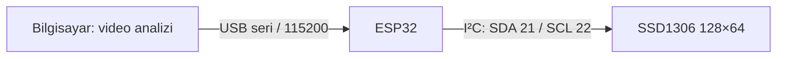

# ESP32 sonuç ekranı

Donanımın görevi, bilgisayardaki analiz sonucunu bağımsız küçük bir ekranda göstermek. Görüntü analizi ESP32 üzerinde çalışmaz. Sensör kullanılmaz.

## Parçalar

| Parça | Adet | Özellik |
|---|---:|---|
| ESP32 DevKit V1 / ESP32-WROOM geliştirme kartı | 1 | USB–seri dönüştürücülü klasik ESP32; `esp32dev` hedefi |
| SSD1306 OLED | 1 | 128×64, I²C, 0x3C, 3.3 V ile uyumlu modül |
| USB veri kablosu | 1 | Kartın konnektörüne uygun; yalnız şarj kablosu olmaz |
| Breadboard ve jumper kablo | 1 takım | İlk prototip için |
| Muhafaza / sabitleme plakası | 1 | Sunumda kart ve ekranı sabitlemek için |

Fiyatlar tedarikçiye göre değişir; satın alma yapılmadı. ESP32-C3/S3 gibi farklı kartlar aynı pin planıyla varsayılmamalı.

## Bağlantı

| ESP32 | OLED |
|---|---|
| 3V3 | VCC |
| GND | GND |
| GPIO 21 | SDA |
| GPIO 22 | SCL |



Kablolamayı USB çıkarılmışken yap. Güç bilgisayarın USB portundan gelir; OLED 3V3 hattına bağlanır. Kart programı başlarken 0x3C adresinin yanıtını kontrol eder.

## Derleme ve yükleme

Proje kökünde:

```powershell
.\.venv\Scripts\python.exe -m pip install platformio
.\.venv\Scripts\python.exe -m platformio run -d firmware
.\.venv\Scripts\python.exe -m platformio run -d firmware --target upload --upload-port COM5
```

`COM5` yerine kartın portunu yaz. Gerekirse kart üzerindeki BOOT düğmesiyle yükleme kipine gir. Ardından uygulamada **Donanım ekranı → Portları yenile → Sonuçları ekrana gönder** kullan. Seri monitör açıksa kapat; aynı COM portunu iki program paylaşamaz.

Kart dört saniyede bir iki sayfa arasında geçer: toplam/FH/BH/belirsiz/incelenen sayıları; hedef oranı, lokalize temas sayısı ve varsa yaklaşma hızı tahmini. Ölçülmeyen sayısal alanlar `--` olur. Bilgisayar bağlantısı kopunca son alınan oturum kalır; yeni sonuç olduğu izlenimi verilmez.

## Haberleşme

115200 baud, 8N1. Her mesaj bir JSON satırı; sürüm `v=1`. Örnek:

```json
{"v":1,"session":"ornek","strokes":5,"forehand":4,"backhand":1,"unknown":0,"localized":5,"unlocalized":0,"hit_rate":80.0,"approach_kmh":null,"reviewed":5}
```

Başarılı yanıt: `{"v":1,"ack":true}`. Bozuk paket/uyumsuz sürüm için `ack:false`. Ekran yoksa kart başarı yanıtı vermez. 767 baytı aşan satır sonraki satır sonuna kadar atılır. Ekran için ASCII etiketler kullanılır.

## Fiziksel kabul testi

1. Kartı USB'den başlat; OLED'de sonuç bekleme yazısını gör.
2. Sentetik örneği gönder; ekrandaki 5 vuruş, 4/1 dağılımı, %80 isabeti bilgisayarla karşılaştır.
3. Mesafesiz gerçek bir oturum gönder; hız alanının `--` olduğunu kontrol et.
4. USB'yi çıkar/tak ve tekrar gönder; uygulama analiz sonuçlarını kaybetmemeli.
5. Ekran bağlantısı olmadan başlat; uygulama başarılı gönderim bildirmemeli.

Bu adımlar fiziksel kartla uygulanmadan donanım doğrulandı sayılmaz. Dersin donanım katkısı için devre, haberleşme protokolü, gömülü yazılım ve muhafazayı rapora dahil et; hocanın özel ölçütleri ayrıca kontrol edilmeli.
