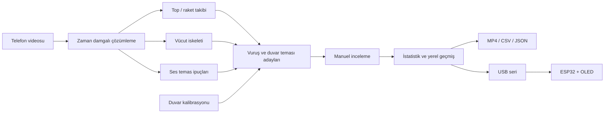

# Mühendislikte Tasarım Esasları — proje taslağı

**Proje adı:** Telefon Videosu Tabanlı Tenis Duvar Antrenmanı Analizi ve Gömülü Sonuç Ekranı

## Problem ve kullanıcı

Amatör bir tenis oyuncusu duvara karşı çalışırken vuruşlarını ve hedef tutarlılığını düzenli kaydedemiyor. Önerilen sistem, mevcut telefonla alınan videodan incelenebilir ölçümler çıkarır; bilgisayarda ayrıntılı analiz ve masaüstü OLED'de kısa özet sunar.

## Gereksinimler

| Gereksinim | Tasarım karşılığı | Kabul yöntemi |
|---|---|---|
| Mevcut telefonla kullanım | Kayıt sonrası yerel video işleme | 1080p/60 FPS orijinal kayıt |
| Vuruş sayısı ve türü | Top/raket/poz ipuçları ve elle inceleme | Ayrı test çekiminde precision/recall/F1 |
| Hedef tutarlılığı | Dört noktalı duvar kalibrasyonu ve temas haritası | Elle işaretlenmiş temas konumları |
| Ölçüm belirsizliğini gösterme | Belirsiz tür, konumsuz temas, boş hız alanı | Eksik/örtülü nesne senaryoları |
| Donanım katkısı | ESP32, I²C OLED, USB seri protokol | Fiziksel ekran–bilgisayar karşılaştırması |
| Düşük başlangıç maliyeti | Mevcut bilgisayar ve telefon; tek kart/ekran | Tedarikten sonra gerçek maliyet tablosu |
| Tekrarlanabilir deney | Orijinal otomatik kayıt ve manuel referans ayrımı | JSON çıktısı, veri bölümü ve sürüm kayıtları |

## Alternatifler ve seçim

İki kamera, radar ve raket sensörü maliyet/kurulum yükü nedeniyle ilk sürümden çıkarıldı. Tek telefonla kayıt sonrası çalışma, kullanıcının tercihi ve mevcut Vega 8 bilgisayar nedeniyle seçildi. Görüntü modeli ESP32 üzerinde çalıştırılmıyor; ESP32 sonuçların alınması, doğrulanması ve OLED'e aktarılması görevini üstleniyor.

Tam otomatik, doğrulanmamış bir antrenör yerine kullanıcı tarafından kontrol edilebilir ölçümler seçildi. İlk prototip renk/hareket takibi ile denenebilir. RF-DETR Nano özel veriyle eğitildiğinde aynı analiz/inceleme arayüzü üzerinden kullanılabilir.

## Mimari

Temel veri türleri `Calibration`, `Sample`, `Shot`, `Session`. Uygulama arka planda analiz yapar. Kare zamanları video PTS değerlerinden türetilir; sabit FPS varsayımıyla hız hesaplanmaz. Tespit edilen ve kısa süreli tahmin edilen top noktaları ayırt edilir. Oturum JSON'ları atomik olarak değiştirilir; özetler SQLite'a kaydedilir.

## Özgün mühendislik katkısı

- Duvar antrenmanına yönelik kalibrasyon, hedef bölgesi ve olay eşleştirme.
- Görüntü/ses ipuçlarının birlikte kullanılması ve ölçülemeyen değerlerin açık gösterimi.
- Algoritma çıktısını bozmadan manuel referans oluşturma ve başarı değerlendirmesi.
- Donanım haberleşme protokolü, bozuk paket kontrolü ve iki sayfalı gömülü ekran yazılımı.
- Kendi antrenman verisinin toplanması, eğitim/test ayrımı ve ölçümlü deney.

## Deney ve teslim

En az 100 gerçek test vuruşunda temas F1 ≥ %90; tür sınıflandırmasında kapsama ≥ %80 ve sınıflandırılanlarda doğruluk ≥ %90 hedeflenir. Henüz saha ölçümü yapılmadığı için bunlar başarı sonucu değil tasarım hedefidir. Hız ölçümünün bağımsız referansla doğrulanması bu eşiklerden ayrı raporlanır.

Teslim paketi: kaynak kodu, kurulum rehberi, bağlantı şeması, parça listesi, firmware, örnek demo, veri hazırlama/eğitim araçları ve test raporu. Fiziksel montaj, gerçek veri toplama ve model eğitimi tamamlandığında rapora gerçek sonuçlar eklenir. Ekran tabanlı donanım kapsamının ders yönergesine uygunluğu hocanın şartlarıyla kontrol edilmelidir.

Sekiz haftalık sıra: iki hafta çekim/prototip, iki hafta etiketleme/eğitim, iki hafta entegrasyon, iki hafta saha testi ve rapor. Mevcut kod ilk prototip ve entegrasyon temelini sağlar.
