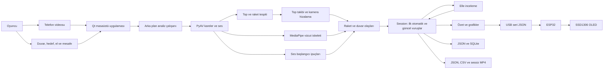
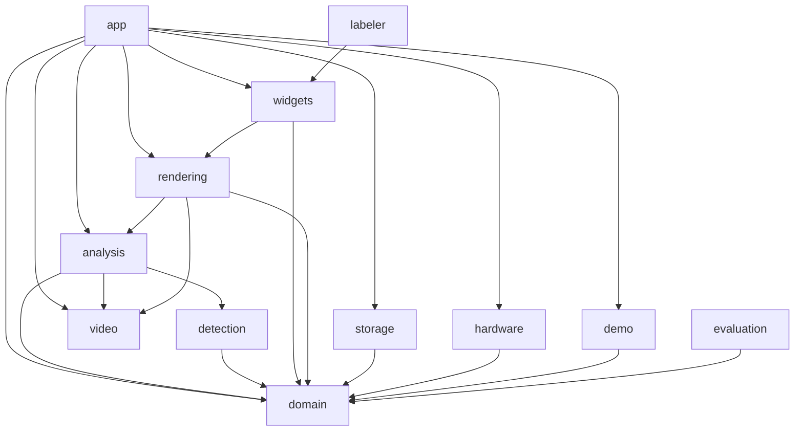
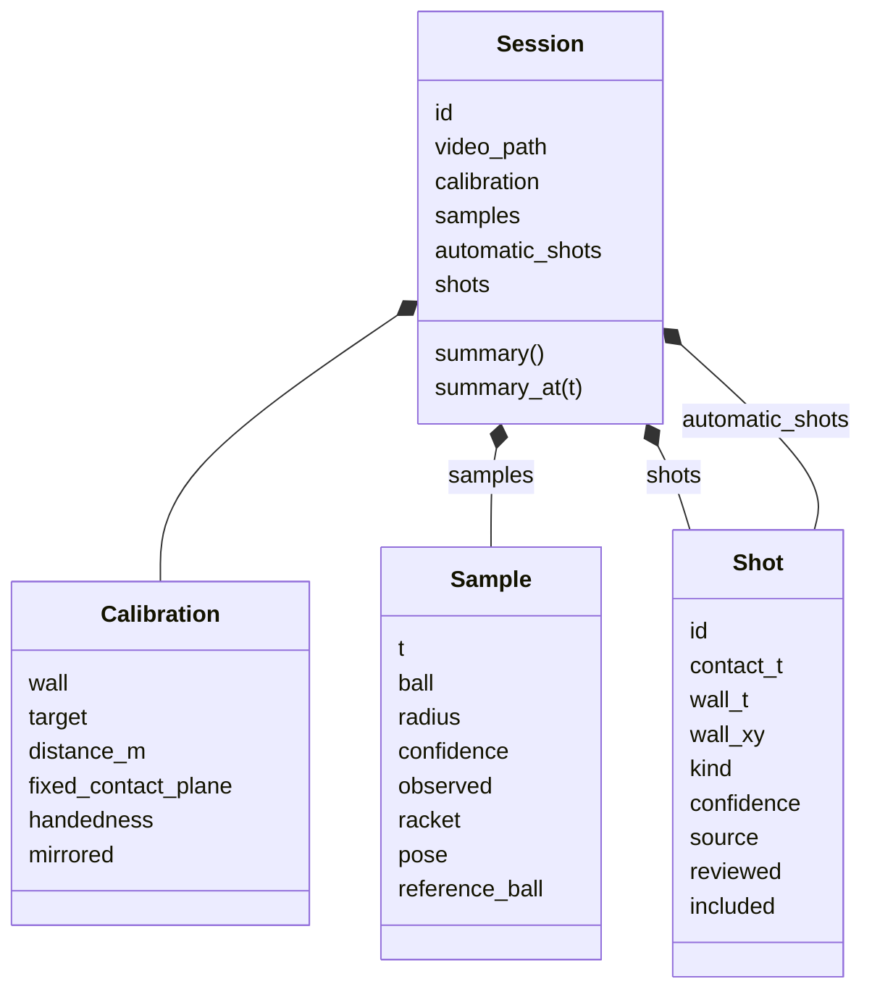
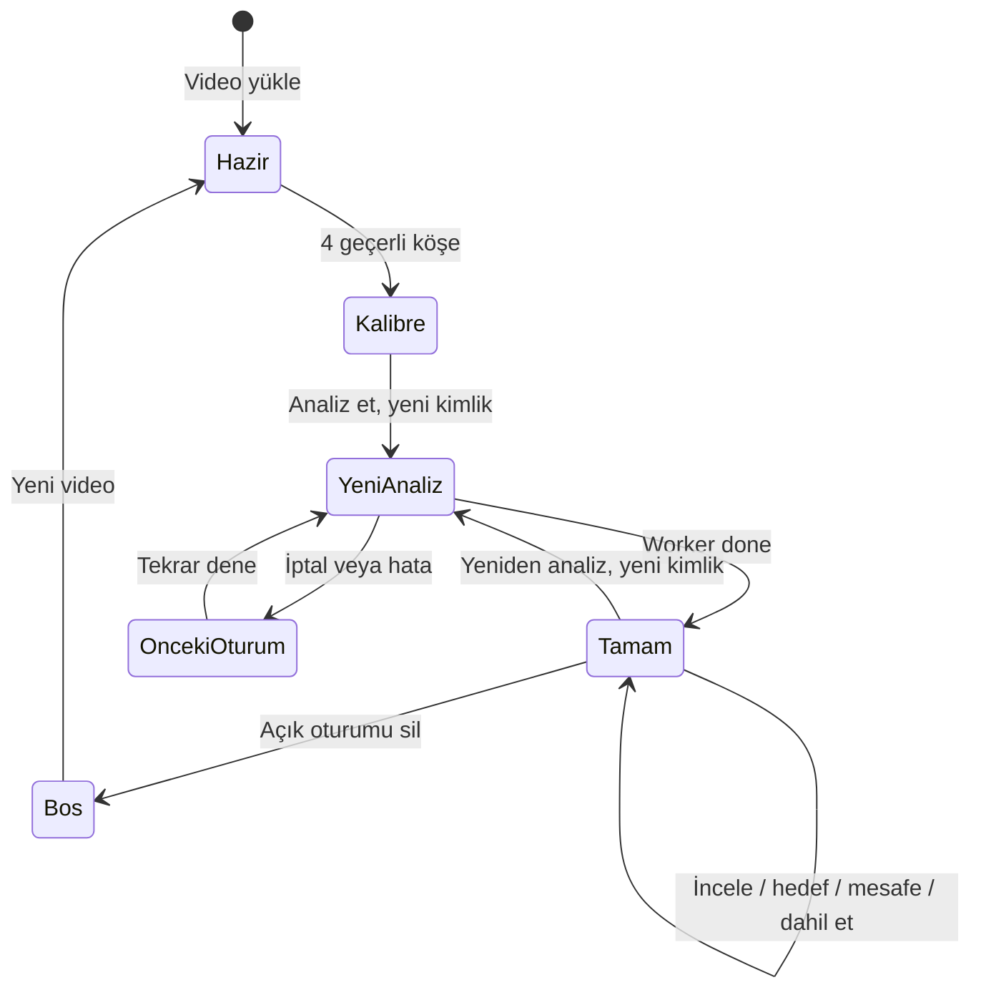
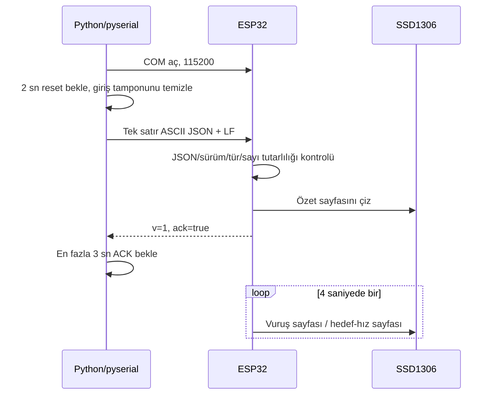

# Duvar Tenis — uçtan uca sistem haritası

İnceleme tarihi: **12 Ekim 2026**. Kapsam: mevcut çalışma ağacı, uygulama kodu, testler, araçlar, notebook, firmware, kurulum ve yerel veri yapısı. Git'e henüz kaydedilmemiş değişiklikler de incelendi. Bu belge mevcut uygulamayı anlatır; tasarım hedefleri ve doğrulanmamış özellikler ayrıca belirtilir.

Makine tarafından okunabilen ayrıntılı dosya, sınıf, fonksiyon, alan, import, sinyal bağlantısı ve test dizini: [SISTEM_ENVANTERI.json](SISTEM_ENVANTERI.json). Dosya yolları proje köküne göredir; envanterdeki satır numaraları bu inceleme anına aittir.

## 1. Sistemin bütünü

**Duvar Tenis, telefonla çekilmiş tenis duvar antrenmanını bilgisayarda sonradan analiz eden, sonuçları kullanıcıya inceleten ve isterse ESP32 OLED'e gönderen yerel bir masaüstü prototipidir.**

| Özellik | Mevcut karşılık |
|---|---|
| Ürün / paket / sürüm | Duvar Tenis / `duvar-tenis` / `0.1.0` |
| Ana çalışma ortamı | Windows, Python, PySide6/Qt |
| Mimari | Tek Python uygulama süreci; Qt ana iş parçacığı ve arka plan `QThread` çalışanı |
| Girdi | Yerel MP4/MOV/MKV/AVI, duvar köşeleri, hedef, el/aynalama, isteğe bağlı mesafe/model |
| Analiz | Top adayları → top takibi + vücut/raket ipuçları → raket/duvar olayları → vuruşlar |
| İnsan kontrolü | Zaman, tür, duvar konumu düzeltme; yeni vuruş; dahil/hariç işareti |
| Kalıcılık | Oturum başına JSON + SQLite geçmiş indeksi |
| Çıktı | Ekran, JSON, CSV, sessiz işaretlenmiş H.264 MP4, seri JSON özeti |
| Donanım | USB seri ESP32; I²C SSD1306 OLED |
| Eğitim | Ayrı COCO veri hazırlama/etiketleme ve CUDA RF-DETR Nano eğitimi |
| Ağ sınırı | Uygulamada video yükleyen sunucu/API akışı yok; paket/model kurulumları internet kullanır |
| Bulunmayan katmanlar | HTTP/REST API, web ön yüzü, hesap/giriş sistemi, bulut veritabanı, canlı kamera akışı, radar/sensör |



## 2. Dosya ve klasör haritası

```text
tennisTracking/
├── Baslat.cmd                    Windows başlatma
├── Kurulum.cmd                   venv, dev/pose paketleri, pose indirme
├── pyproject.toml                paket, bağımlılıklar, CLI, pytest/ruff ayarları
├── requirements-lock.txt         kurulu ortamın sabit sürüm listesi
├── README.md                     kullanım ve proje giriş noktası
├── THIRD_PARTY_NOTICES.md         kaynaklar ve üçüncü taraf notları
├── tennis_tracking/              13 Python modülü, toplam 3330 satır
│   ├── __init__.py               paket açıklaması ve sürüm
│   ├── app.py                    ana pencere, iş akışları, Worker, CLI
│   ├── domain.py                 Calibration, Sample, Shot, Session ve metrikler
│   ├── video.py                  metadata, dönüklük, PTS, seek, ses ipuçları
│   ├── detection.py              renk/RF-DETR/pose tespiti ve top izleyici
│   ├── analysis.py               olay bulma, sınıflandırma, kamera kontrolü
│   ├── widgets.py                video, kartlar, duvar ve hız grafikleri
│   ├── storage.py                SQLite/JSON geçmişi, silme, CSV/JSON dışa aktarım
│   ├── rendering.py              OpenCV bindirmeleri, H.264 MP4 dışa aktarımı
│   ├── hardware.py               seri paket ve ACK bekleme
│   ├── evaluation.py             otomatik çıktı–manuel referans karşılaştırması
│   ├── demo.py                   sentetik video ve hazır örnek etiketler
│   └── labeler.py                ayrı Qt COCO kutu etiketleyici
├── scripts/
│   ├── download_pose.py          sabit SHA256 ile resmi pose modeli
│   ├── extract_frames.py         hash kimlikli seyrek JPG kareler
│   ├── train_detector.py         COCO kontrolü, CUDA eğitim, model paketi
│   └── evaluate.py               kayıtlı oturumu değerlendirip JSON rapor üretme
├── notebooks/train_wall.ipynb    eğitim scriptini GPU ortamında çalıştırma
├── firmware/
│   ├── platformio.ini            ESP32 ve Arduino kütüphaneleri
│   └── src/main.cpp              seri ayrıştırma, doğrulama, iki OLED sayfası
├── tests/                        conftest + 8 test modülü
├── docs/                         çekim, donanım, eğitim, proje ve test belgeleri
├── models/                       model belgesi ve yerel pose ağırlığı
├── data/                         SQLite, oturum JSON'ları, demo, yerel QA çıktıları
├── .venv/                        yerel Python ortamı
├── firmware/.pio/                indirilmiş kütüphaneler/derleme önbelleği
└── .git/, .pytest_cache/, .ruff_cache/, *.egg-info/
```

`datasets/` ve `runs/` araçların beklediği çıktı dizinleridir; inceleme anında yoktur. `.venv`, önbellekler, `data`, model ağırlıkları, `datasets`, `runs` ve `.pio` Git dışında tutulur. `.pio` içindeki üçüncü taraf kütüphaneler uygulamanın kendi kaynak kodu değildir.

Mevcut yardımcı belgeler: [çekim](CEKIM.md), [donanım](DONANIM.md), [model eğitimi](MODEL_EGITIMI.md), [proje taslağı](PROJE.md), [eski doğrulama raporu](TEST_RAPORU.md), [model tanımı](../models/README.md), [üçüncü taraf notları](../THIRD_PARTY_NOTICES.md).

## 3. Modül sorumlulukları ve bağlantıları

| Modül | Ana semboller | Aldığı veri / ürettiği sonuç | Proje içi bağımlılık |
|---|---|---|---|
| `app.py` (1264 satır) | `MainWindow`, `Worker`, `HelpHeader`, `main` | Kullanıcı işlemleri → oturum/ekran/işçi | analysis, domain, hardware, rendering, storage, video, widgets; demo sonradan import edilir |
| `domain.py` (207) | 4 dataclass; `approach_speed_candidate`, `approach_speed` | Koordinatlar/vuruşlar → geometri, özet, serileştirme | Başka proje modülü yok; OpenCV/NumPy kullanır |
| `video.py` (136) | `VideoInfo`, `oriented`, `probe`, `frames`, `frame_at`, `audio_onsets` | Video → metadata, zamanlı BGR kare, ses ipucu | Başka proje modülü yok |
| `detection.py` (170) | `Candidate`, `ColorDetector`, `RFDETRDetector`, `PoseDetector`, `BallTracker` | Kare/adayı → tespit ve `Sample` | domain |
| `analysis.py` (360) | `classify`, `near_racket`, `detect_shots`, `CameraMonitor`, `analyze`, `AnalysisCancelled` | Session/video → otomatik adaylı Session | detection, domain, video |
| `widgets.py` (497) | `VideoCanvas`, `MetricCard`, `LiveMetric`, `WallChart`, `SpeedChart`, `as_qimage` | Session/kare → Qt çizimi ve kullanıcı sinyalleri | domain, rendering (`POSE_EDGES`) |
| `storage.py` (104) | `SessionStore`, `export_json`, `export_csv` | Session ↔ JSON/SQLite; CSV | domain |
| `rendering.py` (146) | `Overlay`, `export_video`, `POSE_EDGES` | Session + kaynak kare → bindirilmiş MP4 | analysis (iptal istisnası), domain, video |
| `hardware.py` (31) | `display_packet`, `send_summary` | Session özeti → ASCII JSON/seri ACK | domain |
| `evaluation.py` (83) | `match_events`, `event_scores`, `evaluate` | İlk otomatik + incelenmiş vuruşlar → metrikler | domain |
| `demo.py` (97) | `create_demo` | Klasör → sentetik video ve Session | domain |
| `labeler.py` (232) | `BoxCanvas`, `LabelWindow`, `main` | JPG ve kutular ↔ COCO JSON | widgets |
| `__init__.py` (3) | `__version__` | Paket sürümü | Yok |



Bu oklar import bağımlılığıdır. `widgets → rendering → analysis → detection` zinciri nedeniyle etiketleyici de analiz modüllerini dolaylı yükler. RF-DETR, MediaPipe ve serial'in bazı importları ihtiyaç anında yapılır. Mevcut proje içi import grafiğinde döngü yoktur. `app.py` ekran kurma, iş akışı, kalıcılık ve hata gösterimini birlikte üstlenen ana koordinatördür.

## 4. Başlatma, kurulum ve süreç yaşamı

1. `Kurulum.cmd` çalışma dizinini proje köküne alır; `python -m venv .venv` çalıştırır.
2. Sanal ortamda `pip install -e ".[dev,pose]"` kurar; RF-DETR bu kurulumda gelmez.
3. `scripts/download_pose.py` modeli indirir/doğrular.
4. `Baslat.cmd` `.venv/Scripts/python.exe -m tennis_tracking.app` ile açar.
5. `main()` argümanları okur, `QApplication` oluşturur, Fusion stilini ve `STYLE` CSS'ini uygular, `MainWindow` açar.
6. `MainWindow` veri deposunu, medya oynatıcıyı, ses çıkışını, video sink'ini ve dört sekmeyi oluşturur; kayıtlı geçmiş ve COM portlarını okur.

| Giriş | Seçenekler / davranış |
|---|---|
| `python -m tennis_tracking.app` veya `duvar-tenis` | `--demo`, `--screenshot PATH`, `--data-dir PATH` |
| `--demo` | 100 ms sonra sentetik örneği açar |
| `--screenshot` | Varsayılan olarak Qt offscreen; Windows fontlarını yükler; 3,5 sn sonra pencere görüntüsünü kaydedip çıkar |
| `--data-dir` | Oturum deposunu değiştirir; pose modeli yine proje `models/` altında aranır |
| `python -m tennis_tracking.labeler FOLDER` | Bağımsız etiketleme penceresi |

`ROOT`, `app.py` dosyasının üst proje dizinidir; varsayılan oturumlar `ROOT/data`, pose `ROOT/models/pose_landmarker_lite.task` içindedir. Ana pencere 1420×960, en az 1060×760'tır; yan panel 210 px, üst video/ayar alanı 470 px yüksekliktedir. Ayar ve antrenman içerikleri kaydırılabilir.

## 5. Ekran ve kullanıcı işlemleri haritası

| Alan | Görünür işlev | Kod yolu / etkisi |
|---|---|---|
| Sol panel | Video yükle | `open_video → load_video → probe/frame_at`; yeni `ready` Session |
| Sol panel | Örnek oturumu keşfet | `load_demo → create_demo → store.save → open_session` |
| Sol panel | Antrenman geçmişi | `refresh_history`; kimlik `Qt.UserRole` içinde; `load_history → store.load` |
| Sol panel | Seçili antrenmanı sil | `delete_history`; UI onayı; `store.delete`; açık oturumsa `clear_session` |
| Başlık | Dışa aktar | `export_results`; JSON/CSV doğrudan, MP4 Worker üzerinden |
| Antrenman | Video ve ses | `QMediaPlayer → QVideoSink → video_frame → VideoCanvas`; ses seviyesi başlangıçta 0,5 |
| Antrenman | Oynat/duraklat, −1/+1 | `toggle_play`, `step`; simge ve erişilebilir isim oynatma durumuna göre |
| Antrenman | Zaman çizgisi | `seek`, `position_changed`; ms → sn, kartlar ve video bindirmesi güncellenir |
| Antrenman | Çekim ayarları | Ad, sağ/sol el, aynalanmış video |
| Antrenman | Ölçüm/takip | Mesafe, sabit mesafe onayı, color/RF-DETR, `.pth` seçimi |
| Antrenman | Mesafeyi oturuma uygula | `apply_distance`; yalnız complete oturum, ≥0,2 m ve onay; yeniden video analizi yapmaz |
| Antrenman | Duvarın dört köşesi | `start_calibration → canvas_clicked → current_calibration.validate` |
| Antrenman | Analiz | `start_analysis → run_work → analyze → analysis_done → persist` |
| Antrenman | Dört büyük kart | Vuruş; FH/BH; hedef oranı; ortalama/peak/FH/BH yaklaşma hızı |
| Video altı | Dört anlık kart | `summary_at(t)`; mevcut ana kadar vuruş, FH/BH, hedef, hız |
| Antrenman | Duvar grafiği | Hedef sürükleme → `change_target`; nokta tıklama → `show_wall_shot` |
| Antrenman | Hız grafiği | Dahil her vuruş için bir yer; tıklama → `show_speed_shot` |
| Vuruş inceleme | Tablo | #, raket sn, duvar sn, tür, hız tahmini, kaynak, durum |
| Vuruş inceleme | Satır seç/çift tıkla | `select_shot` taslağı doldurur; `jump_to_shot` raket anına götürür |
| Vuruş inceleme | Yeni/mevcut anı al | `new_shot`; henüz Session'a eklemez, taslak oluşturur |
| Vuruş inceleme | Duvar anını al/nokta seç | `capture_wall_time` eski taslak konumu temizler; `pick_wall_point → canvas_clicked` |
| Vuruş inceleme | İncelendi · kaydet | `save_shot`; ekle/düzelt, reviewed=true, zamana göre sırala, persist |
| Vuruş inceleme | Dahil et/çıkar | `toggle_shot`; silmez; istatistiklerden/grafiklerden çıkarır |
| Gelişim | Oturum karşılaştırma tablosu | Ad, UTC tarih kesiti, vuruş, hedef %, incelenen, konumsuz, aralık, RMS dağılım |
| Donanım ekranı | Port listesi ve gönderim | `refresh_ports`, `send_device → send_summary`; mevcut oturum özeti |
| Alt bildirim | Durum/uyarı/iptal | `notify`, `error`, ilerleme çubuğu, Worker stop Event |

`HelpHeader`, raket/duvar zamanı ve kaynak sütunlarına bilgi simgesi ve açıklama ekler. Vuruş türü `unknown/forehand/backhand`, ekranda Belirsiz/Forehand/Backhand'dir. Durum sırası: hariçse “Hariç”, dahil ve incelenmişse “İncelendi”, diğer durumda “Aday”.

### Widget içi çizim ve etkileşim

| Widget | Veri / koordinat davranışı |
|---|---|
| `VideoCanvas` | Görüntü oranını korur; yalnız görüntü içindeki tıklamaları normalize eder; `view/calibrate` modları |
| Video bindirmesi | Duvar/hedef, kısa top izi, iskelet, o ana kadar oluşmuş duvar numaraları |
| Top işareti | Gözlenen: dolu sarı/açık yeşil; tahmin: gri/boş; iki gözlenen nokta arasında çizgi |
| `WallChart` | Duvarı görüntüdeki perspektif oranıyla gösterir; duvar koordinatını ters homografiyle grafiğe taşır |
| Hedef sürükleme | Normalize duvar içinde sınırlar; her iki boyutta >0,03 genişlik gerekir |
| Duvar noktası | Yeşil hedef içi, turuncu dışı; reviewed=false ise boş daire; 12 px yakınlıkta tıklama |
| `SpeedChart` | Included vuruşların tümü; yeşil güven filtresinden geçen hız, turuncu aday hız, gri çizgi eksik veri |
| Araç ipuçları | Vuruş sıra numarası, isabet/inceleme durumu, zaman/hızın eksik veya düşük güvenli olması |

Canlı Qt görüntüleyici ve MP4 bindirmesi ayrı çizim kodlarıdır. Qt örnek zaman toleransı 0,1 sn, MP4 bindirmesi 0,08 sn; Qt izi son yaklaşık 13 örneği, dışa aktarım izi son 0,3 sn'yi kullanır.

## 6. Veri modeli — bütün kalıcı alanlar



### Calibration

| Alan | Tür / varsayılan | Anlam |
|---|---|---|
| `wall` | `list[list[float]]`, `[]` | Normalize görüntüde TL, TR, BR, BL |
| `target` | dört float, `[0.3,0.3,0.7,0.7]` | Normalize duvarda x0,y0,x1,y1 |
| `distance_m` | float veya None | Raket temas düzleminden duvara dik ölçülen mesafe |
| `fixed_contact_plane` | bool, false | Ölçülen temas düzleminin sabitliği kullanıcı onayı |
| `handedness` | string, `right` | `right/left` |
| `mirrored` | bool, false | Sınıflandırmada taraf işaretini ters çevirir |

`validate`: dört sonlu 2B nokta; görüntü sınırları 0–1; konveks çokgen; normalize alan ≥0,005; geçerli hedef; varsa mesafe 0,2–30 m; geçerli el. Geometrik doğrulama, kullanıcının gerçek duvar dikdörtgenini doğru seçtiğini kanıtlamaz. `wall_point` görüntü→duvar, `target_polygon` duvar→görüntü, `in_wall` sınır kontrolüdür.

### Sample

| Alan | Tür / varsayılan | Anlam |
|---|---|---|
| `t` | float, zorunlu | İlk video karesine göre saniye |
| `ball` | iki float veya None | Normalize mevcut kare top merkezi |
| `radius` | float veya None | Kare genişliğine bölünmüş yarıçap |
| `confidence` | float, 0 | Tespit adayının skoru; kalibre olasılık değildir |
| `observed` | bool, false | Gerçek tespit mi, izleyici tahmini mi? |
| `racket` | dört float veya None | Normalize x0,y0,x1,y1 raket kutusu |
| `pose` | x,y,visibility listesi veya None | İlk kişi; MediaPipe landmark'ları |
| `reference_ball` | iki float veya None | İlk kamera karesine hizalanmış top konumu |

### Shot

| Alan | Tür / varsayılan | Anlam |
|---|---|---|
| `contact_t` | float, zorunlu | Raket teması zamanı |
| `wall_t` | float veya None | Duvar teması zamanı |
| `wall_xy` | iki float veya None | Homografi sonrası normalize duvar konumu |
| `kind` | string, `unknown` | unknown/forehand/backhand |
| `confidence` | float, 0 | Olay ipuçlarından hesaplanan güven skoru |
| `source` | string, `automatic` | automatic/manual; otomatik vuruş düzeltilince kaynak automatic kalır |
| `reviewed` | bool, false | Kullanıcı “İncelendi · kaydet” yaptı mı? |
| `included` | bool, true | Özet/grafik/referansa dahil mi? |
| `id` | UUID4 hex | Kalıcı vuruş kimliği |

### Session

| Alan | Tür / varsayılan |
|---|---|
| `video_path` | string, zorunlu; kaynak dosyanın yolu |
| `calibration` | Calibration, zorunlu |
| `id` | UUID4 hex; demo için `syntheticdemo` |
| `created_at` | UTC ISO 8601 zamanı |
| `name` | `Duvar antrenmanı` |
| `duration`, `fps` | float, 0 |
| `width`, `height` | int, 0; görüntü dönüklüğü uygulandıktan sonra |
| `detector` | `color`; diğer uygulama seçimi `rfdetr` |
| `status` | `ready`; analiz sırasında `analyzing`, başarıda `complete` |
| `warnings` | string listesi |
| `samples` | Sample listesi; işlenen bütün kareler |
| `automatic_shots` | Shot listesi; analiz sonundaki ilk çıktının deep copy'si |
| `shots` | Shot listesi; kullanıcının gördüğü/düzelttiği güncel sonuç |
| `schema_version` | int, 1 |

`to_dict` dataclass alanlarını iç içe sözlüğe çevirir. `from_dict` yalnız `schema_version=1` kabul eder; kalibrasyon/örnek/vuruşları tekrar nesneye çevirir. Şema göç mekanizması veya bütün yüklenen sayısal alanları doğrulayan ayrı bir validator yoktur.

Geçici tipler: `VideoInfo(width,height,fps,duration,frames,has_audio)` ve `Candidate(xy,radius,confidence)`. Bunlar oturumun ayrı kalıcı alanları değildir.

## 7. Koordinat ve zaman sözleşmeleri

| Uzay | Kullanım | Birim |
|---|---|---|
| Video pikseli | BGR kareler, COCO kutuları, OpenCV çizim | px |
| Normalize görüntü | ball, racket, pose, wall köşeleri | x/width, y/height; sol üst başlangıç |
| Kamera referans görüntüsü | `reference_ball` | İlk kareye hizalanmış normalize x,y |
| Normalize duvar | `wall_xy`, `target`, dağılım/hata | Kalibre dikdörtgende 0–1 |
| Fiziksel mesafe | `distance_m` | m; duvara dik |
| Analiz zamanı | Sample ve Shot | İlk video PTS'sine göre saniye |
| UI zamanı | QMediaPlayer/timeline | ms; gerektiğinde /1000 |
| Pose zamanı | MediaPipe VIDEO | ms; kesin artan tutulur |
| MP4 çıktı zamanı | VideoFrame PTS | 1/90000 sn tabanında |

Homografi yalnız duvar düzlemindeki temas konumuna uygulanır. Havadaki topa homografiyle metre/saniye hızı çıkarılmaz. Normalize duvar mesafesi fiziksel metre değildir; duvarın gerçek genişlik/yüksekliği modelde yoktur.

`frames`, `frame.pts * frame.time_base` değerinden ilk PTS'yi çıkarır. Eksik veya artmayan PTS hata üretir. Telefonun 90/180/270° dönüklüğü kareye uygulanır; analiz en fazla 1280 px genişliğe küçültülür. `frame_at` geriye anahtar kareye seek edip hedef zamana ulaşana kadar çözer. **UI'nin −1/+1 adımı ise ortalama FPS'ten ms hesaplar; değişken FPS'te kesin bitişik kare navigasyonu değildir.**

## 8. Analiz hattı — adım adım

```mermaid
sequenceDiagram
    actor U as Kullanıcı
    participant UI as MainWindow
    participant W as Worker
    participant A as analyze
    participant V as Video/Tespit
    participant S as SessionStore
    U->>UI: Analiz et
    UI->>UI: Kalibrasyonu/model seçimini doğrula
    UI->>UI: Yeni Session oluştur, oynatmayı duraklat
    UI->>W: action(progress,stop) başlat
    W->>A: analyze(yeni session)
    A->>V: probe; detector/pose/tracker/camera hazırla
    loop Zaman damgalı bütün kareler
        A->>V: Kare çöz, top/raket/pose bul
        V-->>A: Sample + kamera referansı
        A-->>W: İlerleme bildir
        W-->>UI: progress sinyali
    end
    A->>V: Ses ipuçları
    A->>A: detect_shots; kamera/görünürlük uyarıları
    A->>A: automatic_shots = deepcopy(shots)
    A-->>W: complete Session
    W-->>UI: done(session)
    UI->>S: session.json + SQLite özeti
    UI->>UI: Kartlar, grafikler, tablo, geçmiş
    U->>UI: Elle düzelt ve kaydet
    UI->>S: Güncel shots; ilk automatic_shots korunur
```

### 8.1. Tespit

**Renk modu:** HSV `[22,65,75]–[48,255,255]` aralığı ile MOG2 hareket maskesinin kesişimi. MOG2 history=180, varThreshold=25, gölge kapalı. Kontur alanı 4 px–görüntü alanının %0,2'si; yarıçap 1,2 px–genişliğin %4'ü; daire doluluk oranı ≥0,18. Skor `min(0.65,0.35+fill*0.3)`. Raket kutusu üretmez; bu moddaki otomatik raket temasının temel ipucu poz bilekleridir.

**RF-DETR modu:** `.pth` + aynı adlı `.json`; mimari RFDETRNano; ball/racket kimlikleri gerekir. Manifestte SHA256 varsa doğrulanır. CPU inference, varsayılan 560 çözünürlük, predict threshold=0,25. Top kutularından merkez/yarıçap adayları; en yüksek güvenli raket kutusu alınır. Manifestteki `rfdetr_version` çalışma anında kontrol edilmez.

**Pose:** MediaPipe PoseLandmarker VIDEO, num_poses=1, tespit/varlık/takip eşikleri 0,5. Bir kişi için x,y,visibility döner. Zaman `max(last_ms+1, round(t*1000))`. Model dosyası yoksa uyarıyla devam eder; dosya mevcutken paket/model yükleme hatası Worker başarısızlığına dönüşür.

### 8.2. Top takibi

`BallTracker` konum, hız, son zaman, son gözlenme zamanı ve yarıçap tutar. İz yokken en güvenli adayı, iz varken tahmin edilen konuma en yakını seçer. Kabul kapısı `min(0.25,max(0.055,|velocity|*dt*2.5))`. Hız güncellemesi %60 yeni hız + %40 eski hızdır. En fazla 0,12 sn gözlemsiz devam eder; tahmin kareleri `observed=false`, confidence=0 kalır. Görüntü dışı tahmin veya uzun kayıp izi sıfırlar. Bu bir çoklu top/oyuncu izleyicisi değildir.

### 8.3. Kamera kontrolü

`CameraMonitor` 320×180 gri görüntüde ilk kareye göre optik akış ve RANSAC kısmi affine dönüşüm kullanır. En çok 120 köşe, en az 12 geçerli nokta; en az 12 ve eşleşmelerin %50'si inlier gerekir. Her 15 karede güncellenir; dönüşüm aradaki karelerde yeniden kullanılır.

| Kontrol | Kayma eşiği | Büyük hareket eşiği |
|---|---|---|
| Öteleme | >5 px | >20 px |
| Ölçek farkı | >0,035 | >0,08 |
| Dönme | >0,025 rad | >0,06 rad |

Üç ardışık kontrol kaymayı/hareketi işaretler. Hafif kaymada ters affine ile duvar konumu ilk kareye hizalanır; “yaklaşık” uyarısı gelir. Büyük harekette güncel vuruşların `wall_xy` alanları temizlenir ve `fixed_contact_plane=false` yapılır; duvar zamanları kalabilir. Yeterli özellik yoksa kamera güvenilir biçimde değerlendirilemeyebilir; bu durumda “hareket bulunmadı” sonucu fiziksel sabitlik kanıtı değildir.

### 8.4. Raket ve duvar olayları

`detect_shots` en az 7 örnek ister. Olay merkezinin kendisi gözlenen top olmalıdır. Yaklaşık ±0,14 sn pencerede gözlenen önce/sonra noktaları; her iki yönde ≥0,07 sn; hareket büyüklüğü ≥0,0015 gerekir. Tahmin noktası tek başına yeni olay yaratmaz; temasın tam karesi kayıpsa yakın gözlenen kare yine aday olabilir.

| Karar | Mevcut eşik / koşul |
|---|---|
| Raket kutusuna yakınlık | Kutuya her yönde 0,025 tolerans |
| Bileğe yakınlık | visibility>0,6; dikey fark<0,16; Öklid uzaklık<0,20 |
| Sıkı bilek yakınlığı | visibility>0,6; dikey fark<0,10; uzaklık<0,14 |
| Raket dönüşü | Yakınlık + düşey dönüş≥0,025; veya cosine≤−0,45 ve düşey≥0,012; veya sıkı bilek + cosine≤−0,45; veya raket kutusu mevcut + cosine≤−0,15 |
| Duvar dönüşü | Duvar içinde + yerel cosine≤−0,15; veya düşey tepe≥0,015 ve radius<0,012 |
| Duvar tepe desteği | Yakın gözlemler ≤0,10 sn; uzak gözlemler 0,15–0,30 sn |
| Duvar boyut filtresi | Merkez radius komşuların küçüğünden >1,35 kat büyükse reddet |
| Sesle hizalama | Görüntü adayına en yakın onset ≤0,06 sn ise zamanı ona al, güvene +0,05 |
| Olay birleştirme | Raket 0,45 sn; duvar 0,18 sn içinde daha güvenli adayı koru |
| Raket→duvar eşleştirme | Raket sonrası 0,12<dt<1,5 sn; sonraki raket olayından önceki ilk duvar |

Olay güveni; tespit skoru, dönüş açısı, raket/bilek kanıtı, düşey dönüş, hareket simetrisi ve duvar tepesi bileşimidir. Ses öncesi üst sınır 0,85, ses desteğiyle 0,9. Duvar eşleşmesi varsa vuruş skoru iki olayın minimumu; yoksa raket skorunun en fazla 0,64'üdür. Eşikler kodda sabittir; ayar dosyası veya eşik kalibrasyon aracı yoktur.

Her raket olayı bir Shot üretir. Duvar bulunamazsa sayılır fakat konumu/hızı yoktur. Yalnız duvar olayı vuruş üretmez. Raket ve duvar geometrisi görüntü hareketine dayalı sezgiseldir; temasın fiziksel olarak gözlendiğini kesinleştirmez.

### 8.5. Forehand / backhand

`classify`: pose ve top bulunmalı; omuz landmark 11/12 visibility≥0,65; omuz aralığı≥0,035. Omuz orta noktasından topa vektör omuz eksenine izdüşürülür. Aynalama işareti ters çevirir; el seçimi baskın tarafı belirler. Merkez çizgisinin %25 omuz genişliği yakınında veya veri yetersizse `unknown` döner. Bu görüntü düzlemi taraf sınıflandırmasıdır; eğitilmiş vuruş hareketi sınıflandırıcısı veya 3B biyomekanik analiz değildir.

### 8.6. Ses

`audio_onsets` sesi mono 16 kHz'e çevirir, 10 ms bloklarda RMS hesaplar. Eşik medyan×3 ile %85 yüzdeliğin büyüğüdür; yerel artış≥1,5 kat ve tepe aralığı>0,08 sn aranır. Video ilk PTS'sine hizalanır. Ses tek başına raket/duvar sınıfını belirlemez. İptalde boş liste döner; analyze sonra stop'u kontrol ederek iptal istisnası üretir.

### 8.7. Analiz çıktısı ve uyarılar

Kare işlemede ilerleme 0–90; ses/olay aşaması 92; başarı 100. `observed / samples <0.35` düşük görünürlük uyarısıdır. Diğer uyarılar: deneysel renk modu, eksik pose modeli, hafif/büyük kamera hareketi, aday bulunamaması. Sonuçlar ve bütün örnekler bellekte birikir; akışla diske yazma/uzun video parçalama yoktur.

## 9. Metrikler — bütün özet alanları

Özetler varsayılan olarak **dahil edilen incelenmiş ve incelenmemiş bütün vuruşları** kullanır. “Güvenilir” burada kod filtresinden geçen tahmin anlamındadır; saha doğrulaması anlamına gelmez.

| Alan | Hesap |
|---|---|
| `strokes` | included vuruş sayısı |
| `forehand`, `backhand`, `unknown` | Included vuruşların tür dağılımı |
| `localized` | Included ve wall_xy mevcut |
| `unlocalized` | strokes − localized |
| `hits` | Hedef sınırları dahil içinde kalan lokalize vuruş |
| `hit_rate` | 100×hits/localized; lokalize yoksa None |
| `approach_kmh` | Güven filtresinden geçen hızların ortalaması, 1 ondalık |
| `peak_kmh` | Aynı güvenli hız kümesinin maksimumu |
| `forehand_kmh`, `backhand_kmh` | Güvenli hızların tür bazında ortalaması |
| `reviewed` | Included ve reviewed sayısı |
| `mean_interval_s` | Sıralı raket zamanlarının ardışık fark ortalaması; <2 vuruşta None |
| `placement_spread` | Duvar noktalarının kendi merkezlerine RMS uzaklığı; <2 noktada None |

Hız adayı: `v = 3.6 × distance_m / (wall_t − contact_t)`. Sabit temas düzlemi onayı, mesafe ve duvar zamanı gerekir; `0.04 < dt ≤ 3` sn. `approach_speed` buna ek olarak incelenmemiş adayda confidence≥0,4 ve dt≤1,5 sn ister. İncelenmiş vuruş bu ikinci güven filtresini aşar; ilk zaman koşulları devam eder. `wall_xy` olmadan geçerli duvar zamanıyla hız hesaplanabilir. Ortalama, her vuruşun yuvarlanmış hızını kullanır; unknown türlerin geçerli hızları genel ortalamaya dahil olur.

Örnek: 4 m / 0,4 sn → 36 km/sa. Bu duvara dik ortalama hız bileşenidir; raketten çıkış, toplam 3B hız veya radar hızı değildir.

`summary_at(t)`, contact_t≤t olanları vuruş sayar. Hedef ve hız için wall_t≤t olanlara bakar; `speed_count` ayrıca döner. Gelecekteki duvar temasını erken saymaz; geri sarınca tekrar hesaplar. Bu anlık özet `unknown`, peak/tür hızları, reviewed, aralık ve yayılım alanlarını döndürmez.

## 10. Oturum durumları, düzenleme ve arka plan işleri



Bu şema UI iş akışıdır; “Kalibre”, “YeniAnaliz” gibi etiketler ayrı Session.status değerleri değildir. Kalıcı status alanları `ready/analyzing/complete`; error/cancelled durumu kalıcı olarak yazılmaz.

`Worker` sinyalleri: progress(int,str), done(object), failed(str), cancelled(). Stop bir `threading.Event`tir. UI tek çalışan tutar; iş sırasında sekmeler, video yükle, demo, export, geçmiş ve silme kapatılır. Başarı/hata/iptalden sonra düğmeler geri açılır ve Worker `deleteLater` ile bırakılır. Analiz iptali kareler arasında, ses sırasında ve olay aşamasından önce; MP4 iptali kareler arasında kontrol edilir. Modelin tek inference çağrısı iptal noktasına kadar tamamlanabilir.

Yeniden analiz yeni Session kimliği açar. Hata/iptalde önceki aktif oturum korunur. Dışa aktarım ve cihaz gönderimi oturum deep copy'si kullanır. İş sürerken pencere kapatma iptal ister ve kapatmayı reddeder; iş bitince yeniden kapatılabilir. `send_summary` stop callback'ini kullanmadığı için donanım gönderimi kendi zaman aşımını bekler.

Elle kayıtta raket zamanı video içinde, varsa duvar zamanı raketten sonra ve video bitişinden önce/eşit olmalıdır. Duvar noktası varsa duvar zamanı zorunludur. Nokta seçimi kalibre duvarın içinde olmalıdır. Elle ekleme `source=manual`, reviewed=true üretir; mevcut otomatik vuruşun source/confidence değerini değiştirmez.

Yeniden kalibrasyon güncel shots'ın wall_xy alanlarını temizler; automatic_shots korunur. Hedef değişimi yeniden analize gerek olmadan oranları hesaplar ve dört köşe varsa oturumu kaydeder. Kalibrasyonun tamamlanması tek başına `persist()` çağırmaz; sonraki kaydetme/analiz/hedef işlemini bekler.

## 11. Depolama, şema ve veri yaşamı

```text
data/                              veya --data-dir
├── sessions.sqlite3               geçmiş indeksi
├── <session_id>/
│   ├── session.json                bütün Session; asıl ayrıntılı kayıt
│   └── session.tmp                 save sırasında geçici
├── syntheticdemo/session.json      demo oturumu
├── demo/synthetic-demo.mp4          demo kaynağı
└── yerel inceleme/QA dosyaları      uygulama veri modelinden bağımsız
```

```sql
CREATE TABLE sessions (
    id TEXT PRIMARY KEY,
    created_at TEXT,
    name TEXT,
    video_path TEXT,
    summary TEXT
);
```

| İşlem | Gerçek davranış |
|---|---|
| Save | JSON UTF-8, ensure_ascii=false, allow_nan=false → session.tmp → replace(session.json) → SQLite INSERT OR REPLACE |
| List | SQLite satırları; created_at azalan sıra; summary JSON string |
| Load | Alfanümerik kimlik → dosyadan JSON → Session.from_dict |
| Delete | Kimlik/symlink/hedef yolu ve DB kaydı kontrolü; oturum klasörünü tüm içeriğiyle kaldır; DB satırını sil |
| Kaynak video | Kopyalanmaz; yalnız yolu saklanır; geçmiş açarken dosya mevcut olmalı |
| Demo | Kaynak video demo/ içinde; syntheticdemo oturumunu silmek bu video dosyasını kaldırmaz |
| Yedekler | Yerelde session.before-*.json dosyaları var; mevcut save akışı bunları otomatik üretmez |

JSON dosya değişimi atomiktir; JSON ve SQLite birlikte tek transaction değildir. DB güncellemesi başarısız olursa dosya/indeks farklılaşabilir. Silmede dosya kaldırma ile DB silme de birlikte atomik değildir. Otomatik kurtarma, klasörden indeks yeniden kurma, şema migration, taşınmış videoyu yeniden bağlama veya dosya yedekleme aracı yoktur. `load` ve `delete` kimliği doğrular; `save` uygulamanın ürettiği kimliğe güvenir.

`created_at` UTC saklanır; geçmiş ekranı ISO metninin ilk 10 karakterini gösterir, Europe/Istanbul'a dönüştürmez.

## 12. Dışa aktarım sözleşmeleri

| Format | İçerik / davranış |
|---|---|
| JSON | Bütün Session: samples, automatic_shots, shots, calibration dahil; indent=2, UTF-8, NaN yasak |
| CSV | Güncel shots'ın **tümü**, hariç vuruşlar da included=false sütunuyla; UTF-8 BOM |
| MP4 | Kaynak kareler + duvar/hedef/top/iskelet/numara + o anki vuruş sayısı; yalnız video, ses yok |

CSV sütunları: `id,contact_s,wall_s,type,wall_x,wall_y,approach_kmh_estimate,confidence,source,reviewed,included`. Güven filtresinden geçmeyen hız CSV'de boş kalır; UI'deki düşük güvenli `≈` aday hız ayrı sütun olarak dışa aktarılmaz.

MP4: libx264, yuv420p, CRF=22, preset=fast, FPS için nominal oran ve zaman damgaları için 1/90000 time base. Tek sayılı genişlik/yükseklik kenar çoğaltmayla çift yapılır. Önce `<stem>.partial.mp4` yazılır; başarıda hedefe replace; hata/iptalde partial silinir. Kaynak video yolunun üzerine MP4 yazmak reddedilir. Çıktı bindirmesinde “REVIEW REQUIRED | Estimated measurements” etiketi her durumda bulunur. JSON/CSV export dosyası için aynı geçici-dosya akışı yoktur.

## 13. ESP32, devre ve protokol

| Katman | Ayar |
|---|---|
| Kart | PlatformIO esp32dev, espressif32@6.10.0, Arduino |
| USB seri | 115200 baud; pyserial varsayılan 8N1 |
| OLED | Adafruit SSD1306 128×64, I²C 0x3C |
| Kablolar | ESP32 3V3→VCC, GND→GND, GPIO21→SDA, GPIO22→SCL |
| Kütüphaneler | SSD1306@2.5.13, GFX@1.12.1, ArduinoJson@7.4.2 |



`display_packet` paketi `{"v":1,"session":id[:12],**session.summary()}` biçimindedir. Dolayısıyla belgelerdeki kısa örnekten daha fazla özet alanı gönderilir. None JSON null olur. Paket kompakt ASCII'dir, bir LF ile sonlanır.

Firmware'in okuduğu alanlar: v, strokes, forehand, backhand, unknown, reviewed, localized, hit_rate, approach_kmh. session, unlocalized, hits, peak/tür hızları, aralık/yayılım gibi diğer alanlar görüntülenmez. Sayaçlar negatif olamaz; FH+BH+unknown=total; reviewed/localized≤total; hit_rate 0–100; hız≥0 veya null olmalıdır. Eksik hit_rate/approach_kmh null gibi kabul edilir; gerekli sayaçlar yoksa reddedilir.

Başarı: `{"v":1,"ack":true}`. Bozuk paket: ack=false. Ekran yoksa ack=false ve error=display. PC yalnız başarı satırının **tam bayt eşleşmesini** kabul eder; diğer yanıtları açıklayıcı hata olarak ayrıştırmaz, zaman aşımına kadar bekler. read timeout=0,5 sn, write timeout=2 sn, ACK deadline=3 sn.

Seri satır sınırı 767 bayt; taşan satır LF'ye kadar atılır. CR yok sayılır. OLED başlangıçta I²C adresi ve ekran başlatmasını kontrol eder. Sayfa 1 toplam/FH/BH/belirsiz/incelenen; sayfa 2 hedef/lokalize/hız/radar değildir. Sonuç yalnız RAM'de kalır; kart resetiyle silinir. USB kesildiğinde kart enerji almaya devam ederse son sonucu göstermeye devam eder; bağlantı kopma/zaman eskiliği göstergesi yoktur.

Kart video analizi yapmaz, sensör okumaz ve firmware'de Wi-Fi bağlantısı kurulmaz. Bu incelemede kart derlemesi/yüklemesi veya fiziksel cihaz testi yapılmadı; önceki rapor bunları doğrulanmamış olarak kaydediyor.

## 14. Veri seti ve model eğitimi

```mermaid
flowchart LR
    Record[Ayrı gerçek çekimler] --> Split[Oturum bazında train-valid-test seç]
    Split --> Extract[extract_frames.py]
    Extract --> JPG[Hash adlı JPG kareler]
    JPG --> Label[labeler: top ve raket kutuları]
    Label --> COCO[_annotations.coco.json]
    COCO --> Validate[validate_dataset]
    Validate --> Train[CUDA RFDETRNano eğitimi]
    Train --> Bundle[wall-nano.pth + wall-nano.json]
    Bundle --> App[CPU uygulama analizi]
    App --> Review[Tam manuel test referansı]
    Review --> Evaluate[evaluate.py metrik raporu]
```



| Araç | Parametre / çıktı |
|---|---|
| `extract_frames.py VIDEO` | --dataset=datasets/wall; zorunlu --split=train/valid/test; --hz=2, izin 0<hz≤60 |
| Kare kimliği | Video SHA256 ilk 16 karakter + `_` + 7 basamak kare indeksi + .jpg |
| Kare yazma | İlk kare ve seyrek zaman örnekleri; JPG kalite 95; Türkçe Windows yolu için imencode/tofile |
| Sızıntı kontrolü | Aynı hash başka split JPG'lerinde varsa reddet; aynı çekimin yeniden kodlanmış/bölünmüş dosyalarını tanımaz |
| Etiketleyici | JPG; B=ball/0, R=racket/1, N=kaydet/sonraki, Backspace=son kutuyu sil |
| COCO | images, annotations, categories; bbox piksel x,y,w,h; area, iscrowd=0 |
| Kaydetme | Yalnız kaydedilen kareler COCO'ya girer; kutusuz kare negatif örnek; kapanış ve önceki/sonraki mevcut kareyi kaydeder |
| COCO kontrolü | Üç split gerekir; her biri en az bir görüntü/anotasyon; sınıflar tam 0=ball,1=racket; dosyalar/referanslar/pozitif kutu boyutu |
| `train_detector.py` | --dataset=datasets/wall; --output=runs/wall-nano; --epochs=40; --check-only |
| Eğitim | CUDA zorunlu; Nano resolution=560; batch=2; grad accumulation=8; lr=1e-4; early stopping patience=8 |
| Eğitim log servisleri | tensorboard=false, wandb=false |
| Model paketleme | checkpoint_best_total.pth → wall-nano.pth; JSON'a mimari, sınıflar, sürüm, çözünürlük, SHA256, dataset yolu |
| Notebook | rfdetr==1.11.0 kurar; GPU/script kontrolü; check-only; eğitim; indirme talimatı |

Etiketleyici normalize kutularla çizim yapar; COCO'ya piksel birimleriyle yazar. Her save'de `_annotations.coco.tmp` üzerinden replace eder. Veri/model GPU ortamına otomatik gönderilmez; notebook dosyaların zaten yerleştirilmesini bekler. Ön eğitim ağırlıkları RF-DETR tarafından ilk kullanımda indirilebilir.

Model indirme scripti yalnız resmi Pose Landmarker Lite float16/1 `.task` dosyasını indirir; beklenen SHA256 kodda sabittir. Yeni indirmede geçici `.download` ve en az 1 MB kontrolü; yeni/mevcut dosyada digest eşleşmesi; `.sha256` kayıt dosyası vardır. RF-DETR manifest SHA256 kontrolü ise yalnız alan verilmişse uygulanır.

## 15. Değerlendirme ve kanıt sınırı

`evaluate(session,tolerance=0.08)`, included güncel shots'ı manuel referans, automatic_shots'ı ilk tahmin kabul eder. Dahil referansların hepsi reviewed olmalıdır; `syntheticdemo` reddedilir. Boş bir referansın eksiksiz incelendiğini ayrıca kanıtlayan durum alanı yoktur.

Olaylar zaman sırasına alınır; sabit tolerans içinde en erken mümkün bire bir eşleşme yapılır. Aynı referansa iki tahmin sayılmaz. Raket ve duvar zamanları ayrı eşleştirilir; duvar skoru raket eşleşmesinden bağımsızdır. Konum hatası ve tür karşılaştırması raket eşleşmeleri üzerinden hesaplanır.

| Çıktı | Anlam |
|---|---|
| tolerance_seconds | Varsayılan ±0,08 sn |
| reference_strokes | Included referans vuruş sayısı |
| racket_contacts / wall_contacts | tp,fp,fn,precision,recall,f1 |
| classification_coverage | Eşleşmiş ve iki tarafta türü bilinen çift / türü bilinen referans sayısı |
| classification_accuracy | Bu çiftlerde doğru tür oranı |
| placement_mean_normalized_error | İki tarafta konum olan raket eşleşmelerinde ortalama Öklid hata |
| placement_evaluated | Konum hatasına giren eşleşme sayısı |
| speed_validated | Daima false |

CLI toleransı 0–1 sn arasında açık aralıkla doğrular; --output verilirse raporu yazar, her durumda stdout'a basar. Eğitim ve test çekimlerinin bağımsızlığını evaluate doğrulamaz; bunu veri hazırlama ve deney düzeni sağlamalıdır. Tam incelenmiş referans bulunmadan mevcut otomatik sayılar başarı yüzdesi olarak yorumlanamaz. Belgelerdeki F1≥%90, sınıflandırma kapsaması≥%80/doğruluğu≥%90 ve ≥100 test vuruşu **tasarım hedefleridir**.

## 16. Bağımlılıklar ve yerel çalışma ortamı

| Paket | pyproject sözleşmesi | İncelenen .venv sürümü |
|---|---|---|
| Python | ≥3.11,<3.14 | 3.11.9, Windows 64 bit |
| NumPy | ≥1.26,<3 | 2.4.6 |
| opencv-contrib-python | ≥4.10,<5 | 4.14.0.94 |
| PyAV | ≥14,<19 | 18.1.0 |
| PySide6 | ≥6.8,<7 | 6.11.2 |
| pyserial | ≥3.5,<4 | 3.5 |
| MediaPipe (pose/ai) | ≥0.10.20,<0.11 | 0.10.35 |
| RF-DETR (ai) | ==1.11.0 | Kurulu değil |
| pytest (dev) | ≥8,<10 | 9.1.1 |
| Ruff (dev) | ≥0.11,<1 | 0.16.9 |
| PlatformIO | pyproject bağımlılığı değil | 6.2.0 |

`setuptools>=69` build backend; paket keşfi tennis_tracking*. Pytest yalnız tests/ dizinini çalıştırır. Ruff line-length=110, target py311; E4,E7,E9,F,I denetimleri. Bunlar tam bir güvenlik/tip analizi veya bütün stil kuralları değildir. `requirements-lock.txt` sabit sürümler içerir; `Kurulum.cmd` bu listeyi kullanmaz, pyproject aralıklarından kurar. Dolayısıyla yeni kurulumun aynı paket sürümlerini seçmesi garanti değildir.

## 17. Test haritası ve bu incelemedeki sonuçlar

12 Ekim 2026'da mevcut çalışma ağacında çalıştırıldı:

```powershell
.\.venv\Scripts\python.exe -m pytest -q
# 64 passed in 28.11s
.\.venv\Scripts\python.exe -m ruff check tennis_tracking scripts tests
# All checks passed!
.\.venv\Scripts\python.exe -m pip check
# No broken requirements found.
```

| Test dosyası | Fonksiyon / çalıştırılan vaka | Doğruladığı davranış |
|---|---|---|
| test_analysis.py | 19 / 19 | El/omuz sınıflandırma; iz kaybı/yanıltıcı aday; olay eşleştirme; konumsuz vuruş; kamera; renk; model yokluğu; iptal; sentetik pipeline |
| test_domain.py | 11 / 14 | Perspektif ve 4 geçersiz geometri; hız güveni; anlık/toplam özet; payda; kayıt/ilk çıktı; silme; seri paket; şema |
| test_ui.py | 17 / 17 | Play ikonları; silme/onayı iptal; inceleme/geçmiş; hedef; kamera etiketi; duvar/hız tıklama; açıklamalar; mesafe; anlık metrikler; dönüklük; kaydırma |
| test_video.py | 6 / 6 | Probe/seek, VFR PTS, dönüklük, MP4 roundtrip, partial temizleme, kaynak üzerine yazmayı reddetme |
| test_audio.py | 1 / 1 | Stereo ses zamanlarının iki katına çıkmaması |
| test_dataset.py | 2 / 2 | COCO kutusu piksel dönüşümü ve split sızıntısı reddi |
| test_evaluation.py | 4 / 4 | Maksimum eşleşme; duplicate/missed; incelenmemiş referans ve demo reddi |
| test_pose.py | 1 / 1 | Mevcut gerçek MediaPipe modelinin boş karede yüklenmesi/çalışması |

61 test fonksiyonu, parametrizasyonla 64 vaka vardır; bu çalıştırmada skip yoktur. `conftest` Qt'yi offscreen açar ve geçici klasörde sentetik demo oluşturur; testler kullanıcı oturumlarını fixture olarak değiştirmez. Pose boş-kare testi gerçek modele yükleme kanıtıdır, oyuncu/teknik doğruluk kanıtı değildir.

Test edilmeyen başlıca alanlar: gerçek saha doğruluk benchmark'ı; eğitilmiş RF-DETR inference/eğitim; fiziksel seri ACK ve OLED; firmware derleme; disk/DB hata kurtarma; uzun video performansı; kapsamlı Worker/donanım iptal senaryoları. Coverage ölçümü ve otomatik CI iş akışı bu depoda yoktur; test geçişi bütün dalların test edildiği anlamına gelmez.

## 18. Yerel veri ve belgeler arasındaki güncel farklar

| İnceleme anındaki bulgu | Kanıt / yorum |
|---|---|
| SQLite'da 16 oturum | data/sessions.sqlite3, salt okunur sorgu |
| 15 complete, 1 ready | Mevcut 16 session.json |
| 2 gerçek kaynak video adı | IMG_6118.MP4 için 11, IMG_6119.MP4 için 4 kayıt; bir demo |
| Kaynaklar bulunabiliyor | 16 oturumun video_path dosyası inceleme anında mevcut |
| Gerçek video süreleri | Yaklaşık 38,01 ve 14,23 sn; örnek sayıları 1140 ve 427 |
| İlk/güncel gerçek adaylar | Eski kayıtlarda 0/1 gibi, daha sonraki kayıtlarda 27 ve 8 gibi farklı sonuçlar var; farklı denemeleri tek benchmark diye birleştirmemek gerekir |
| Gerçek referans incelemesi | Toplam yalnız 2 included vuruş reviewed; dolu gerçek oturumların hiçbiri tamamen reviewed değil |
| Yerel yedekler | 11 session.before-*.json; mevcut uygulama bunları kendiliğinden üretmiyor |
| Pose mevcut ve hash eşleşiyor | .task SHA256 kodda beklenen değerle aynı |
| Tenise özel model yok | models/ içinde .pth yok; rfdetr paketi kurulu değil |
| Eğitim veri/çıktısı yok | datasets/ ve runs/ mevcut değil |

README ve 29 Eylül tarihli TEST_RAPORU'ndaki “kullanıcı videosu yok” bilgisi mevcut yerel kayıtlarla artık uyuşmuyor. “Ölçülmüş saha başarısı yok” sonucu ise hâlâ geçerli: gerçek görüntünün işlenmesi, bağımsız ve eksiksiz referansla doğruluk ölçmek değildir. Eski rapordaki 38 test bilgisi tarihsel bir çalıştırmadır; bu haritanın güncel çalıştırması 64 vakadır.

Mevcut Git çalışma ağacında bu inceleme başlamadan önce README.md, app.py, storage.py, test_domain.py ve test_ui.py değişmiş durumdaydı. Harita bu dosyaların güncel içeriğini esas alır; satır numaraları ileride değişebilir.

## 19. Uygulanmış özellikler ve açık sınırlar

| Alan | Mevcut durum | Sonucu |
|---|---|---|
| Yerel oynatma/kalibrasyon/inceleme | Uygulanmış, testlerle destekleniyor | Kullanıcı düzeltmesi temel çalışma yolunun parçası |
| Renk tabanlı otomatik tespit | Sezgisel prototip; gerçek kayıtlarda çıktılar var | Model doğruluk iddiası veya saha F1 sonucu yok |
| Pose | Model mevcut ve yükleme testi geçti | Tek kişi ve görüntü düzlemi; 3B teknik değerlendirme yok |
| RF-DETR | Bağdaştırıcı/eğitim akışı var | Paket/ağırlık/veri seti eksik; fiilen kullanılabilir özel model yok |
| Hız | Mesafe ve temas zamanlarına bağlı hesap | Kullanıcı onayı fiziksel sabitliği ölçmüyor; radar doğrulaması yok |
| İlk otomatik kayıt | Shot listesi deep copy ile korunuyor | Orijinal kalibrasyon/model/algoritma sürümünün ayrı tam snapshot'ı yok |
| Yeniden kalibrasyon | Güncel duvar konumları temizleniyor | Eski automatic_shots farklı koordinat çerçevesinde kalabilir; bu durumda konum değerlendirmesi yanıltıcı olabilir |
| Geçmiş/kalıcılık | JSON + SQLite | Çift depolama için ortak atomic transaction/onarım yok |
| Model doğrulama | Mimari/sınıflar ve varsa SHA256 | Eksik SHA256 reddedilmiyor; sürüm uyumu zorunlu doğrulanmıyor |
| Çekim ayrımı | Hash/prefix kontrolü | Yeniden kodlanan/bölünen aynı çekimi otomatik ayıramıyor |
| UI kare adımı | Nominal FPS'e göre | VFR'de bitişik kare garantisi yok |
| Hata/izleme | Bildirim + QMessageBox; Worker str(exc) | Kalıcı uygulama günlüğü/traceback/telemetri yok |
| Donanım iptali/yanıt | Süreli seri bekleme, tam ACK eşleşmesi | Stop donanım fonksiyonunda uygulanmıyor; nack ayrıntısı UI'ye taşınmıyor |
| Firmware | Kaynak ve pin/protokol tanımı var | Derleme ve fiziksel çalışma bu incelemede doğrulanmadı |
| Dağıtım | Kaynak + venv/kurulum scriptleri | EXE/installer, container veya CI teslim hattı yok |

Bu satırlar mevcut davranışın sınırlarıdır; bu haritalama kapsamında uygulama mantığı değiştirilmedi. Öncelikli geliştirme sırası: eksiksiz gerçek referans ve benchmark; algoritma/model/kalibrasyon kökeninin kaydı; veri deposu tutarlılığı; eğitilmiş model; donanım doğrulaması; uzun video/iptal ve zaman navigasyonu iyileştirmeleri.

## 20. Bir değişiklik yapılacağı zaman hangi parçaya gidilir?

| İstenen değişiklik | Birincil yer | Etkilenen yerler |
|---|---|---|
| Yeni metrik | domain.Session.summary/summary_at | app kartları/geçmiş, hardware paketi, firmware, test_domain/test_ui |
| Top tespit yöntemi | detection | analysis detector seçimi, app seçimi, pyproject, test_analysis |
| Vuruş eşikleri/eşleştirme | analysis.detect_shots | domain güvenli hız, evaluation, test_analysis |
| FH/BH mantığı | analysis.classify | Calibration el/aynalama, test_analysis |
| Kalibrasyon/koordinat | domain.Calibration | CameraMonitor, app tıklamalar, widgets, rendering, değerlendirme |
| Yeni ekran/işlem | app.MainWindow | widgets, ilgili test_ui |
| Kalıcı alan/şema | domain dataclass/from_dict | storage, export, evaluation, eski kayıt uyumu |
| Geçmiş silme/kurtarma | storage.SessionStore + app | test_domain/test_ui; JSON/SQLite tutarlılığı |
| Video zamanı/dönüklüğü | video | Qt video_frame/step, rendering, audio, test_video/test_audio |
| MP4 görünümü | rendering.Overlay/export_video | widgets.VideoCanvas ile görsel tutarlılık, test_video |
| Seri protokol | hardware + firmware/main.cpp | device UI, DONANIM.md, seri paket testi |
| COCO/etiket | labeler + train_detector.validate_dataset | extract_frames, notebook, test_dataset |
| Model eğitimi/paketi | train_detector + models/README | detection.RFDETRDetector, notebook, MODEL_EGITIMI.md |
| Başarı ölçümü | evaluation + scripts/evaluate | Manuel referans akışı, test_evaluation |
| Kurulum/paketleme | pyproject + Kurulum/Baslat + lock | README, ortam/bağımlılık kontrolü |

Her sınıf/fonksiyonun adı, parametreleri, dosyası, başlangıç/bitiş satırı; kalıcı dataclass alanları; importlar; Qt sinyal bağlantıları; CLI argümanları ve test adları için [ayrıntılı envanteri](SISTEM_ENVANTERI.json) kullan.
